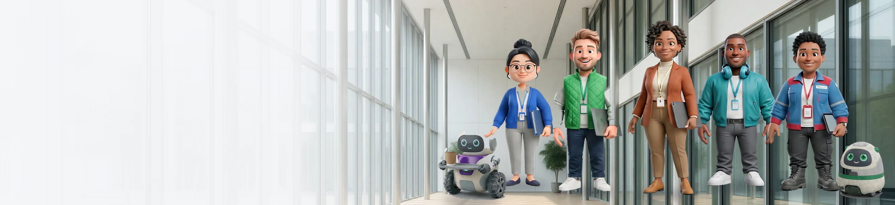

  <a href="https://github.com/oddessentials/agent-guild-builders/releases/latest">
    <picture>
      <source media="(prefers-color-scheme: dark)" srcset=".github/assets/install-now-dark.svg" />
      <source media="(prefers-color-scheme: light)" srcset=".github/assets/install-now-light.svg" />
      
    </picture>
  </a>

  On a Mac (macOS 13 or later): <a href="https://github.com/oddessentials/agent-guild-builders/releases/latest/download/AgentGuildBuilders-macos.zip">download for Mac</a>

  <a href="https://oddessentials.github.io/agent-guild-builders/">For agents</a>

Opening Builders on a Mac for the first time

Builders isn't notarized by Apple, so macOS asks before it first opens.

1. Unzip the download if your browser didn't, and drag `AgentGuildBuilders` into Applications. Open it from there, so agents you connect can find it.
2. Open it. macOS says it can't verify the app. Choose Done.
3. Open System Settings, then Privacy & Security. Under Security, choose Open Anyway next to AgentGuildBuilders, and confirm.

It opens normally from then on. On macOS 13 or 14 you can instead Control-click the app, choose Open, then Open again.

  <a href="https://github.com/oddessentials/agent-guild-builders/releases/latest">
    <picture>
      <source media="(prefers-color-scheme: dark)" srcset="data/brand/hero-dark.webp" />
      <source media="(prefers-color-scheme: light)" srcset="data/brand/hero-light.webp" />
      
    </picture>
  </a>

